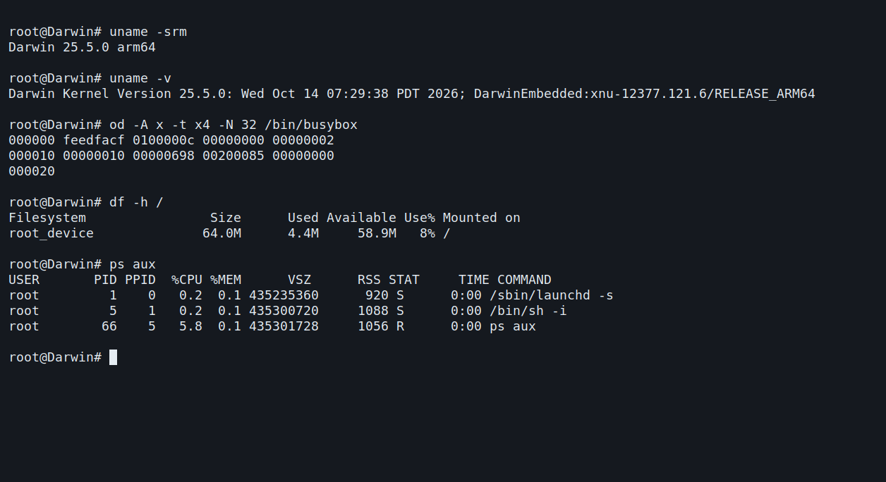
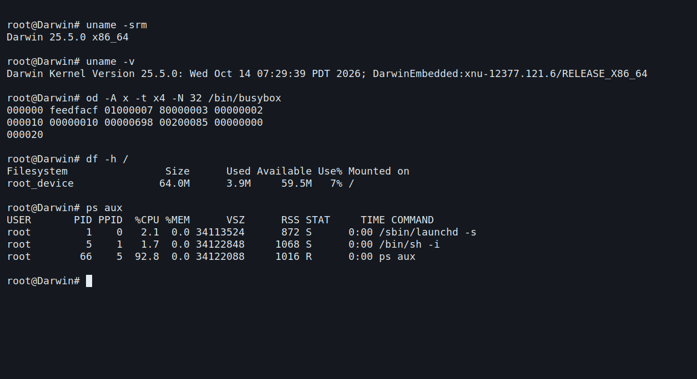
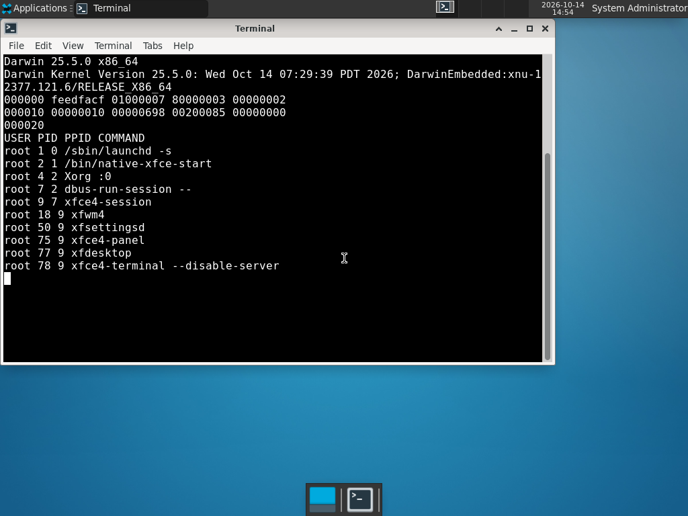

# Darwin Embedded

Boot XNU/Darwin with a native Mach-O userland on **x86_64 and ARM64**.
Two root images are available: an interactive shell and an Xfce4 desktop.
The supported kernel is **XNU 12377.121.6 / Darwin 25.5.0**.
Guest applications use Darwin and Mach APIs directly.

Darwin Embedded is derived from [PureDarwin](https://github.com/PureDarwin/PureDarwin),
including its PC platform/storage support and compatibility headers.
The supported hardware paths use the project's [Pi 4B platform module](src/Kernel/Extensions/25.5.0/BCM2711Platform/README.md)
and [PC UEFI loader](bootloader/pc_uefi/README.md).

| Setup | Guest applications | Root image | QEMU machine |
| --- | --- | --- | --- |
| Minimal x86_64 | dash, native uname, BusyBox with 111 applets | 64 MiB HFS+ | q35 / Penryn |
| Minimal ARM64 | dash, native uname, BusyBox with 111 applets | 64 MiB HFS+ | raspi4b / Cortex-A72 |
| Xfce4 x86_64 | Xorg, Xfce session, xfwm4, settings, panels, desktop and original Xfce terminal/VTE | 128 MiB HFS+ | q35 / Penryn |
| Xfce4 ARM64 | The same native desktop stack | 128 MiB HFS+ | raspi4b / Cortex-A72 |

The screenshots below were refreshed on October 14, 2026, after replacing the
platform module with `BCM2711Platform` and the PC loader with `pc_uefi`.
Each shows Darwin kernel identity and the Mach-O header of a guest executable.
The desktop captures are QEMU framebuffer dumps; the minimal captures show
their serial consoles.
[Validation details](docs/VALIDATION.md) explain the kernel, architecture,
process and executable checks and provide commands to reproduce them.

## Minimal shell





## Xfce4 desktop




## Build and run

Use Bazel for all builds. The build cross-compiles the guest applications and
runtime from source. Firmware is fetched from a pinned publisher package and
checked against recorded SHA-256 digests.

```sh
bazel build //minimal_rootfs:images //rootfs:images

# Interactive minimal serial consoles; Ctrl-] exits.
bazel run //userland/apps/init:verify_arm64 -- --interactive
bazel run //userland/apps/init:verify_x86_64 -- --interactive

# Graphical desktops with a serial console; Ctrl-] exits.
bazel run //rootfs:boot_arm64
bazel run //rootfs:boot_x86_64
```

Desktop targets open a QEMU GTK window. Cold startup under software emulation
can take several minutes. Add `-- --verify-before-interactive` to check native
utilities, desktop startup and hardware keyboard input before retaining the
running desktop. Headless verification commands appear in
[VALIDATION.md](docs/VALIDATION.md).

The build requires Bazel, LLVM/Clang/LLD 20, GCC/G++, Python 3 with `pexpect`
and Pillow, QEMU with `raspi4b` and GTK support, and standard Unix build tools.
It also uses GNU Make for the XNU build, tcsh, m4, bison, flex, binutils, GLib
generators, gdisk, mtools, xxd, zstd and HFS+ formatting/checking tools.
Host tools need development libraries for zlib, OpenSSL, libxml2 and UUID.
Application compilation and linking are driven by Bazel actions.

Inside either guest, use `ls`, `cp`, `grep`, `find`, `df -h`, `ps aux`, `vi`,
`less`, `bc`, and archive/checksum commands. `busybox --list` shows the selected
applets. `/bin/sh` is dash; the Darwin `ps` and `df` implementations query real
kernel process and filesystem information.

## Scope

This is an embedded Darwin port with verified shell and desktop startup in
QEMU. Physical hardware, ARM SMP, broad peripheral support and a complete
macOS service environment have not been verified. The embedded profile omits
optional desktop services and Apple's complete trust-cache infrastructure.
[ARCHITECTURE.md](docs/ARCHITECTURE.md) describes the runtime and its limits.

## License

Original project code is [BSD-2-Clause](LICENSE), matching
[PureDarwin's original-code license](PUREDARWIN_LICENSE.txt). Imported and derived code
retains its upstream licenses. Read [NOTICE](NOTICE) and
[THIRD_PARTY_NOTICES.md](THIRD_PARTY_NOTICES.md), including the remaining binary
redistribution assessment for GPL and APSL components, before publishing
built image releases. The repository supplies source and notices.
